In this section, you will find the R code that we will use during the course. We will explain the code and output during correction of the exercises.

## Source of data

We will work with RNA sequencing data generated by [Ercolano et al 2020](https://jlb.onlinelibrary.wiley.com/doi/10.1002/JLB.5MA0120-209R). This study described the transcriptomes of immune cells that are circulating in the blood of humans in healthy conditions. Different types of immune cells circulate in human blood. In this study, 2 cell types were included: Natural Killer (NK) cells and CD4+ T helper (Th) cells. These 2 types of cells have different functions: NK cells provide a rapid response in the innate immune response at the beginning of an infection such as by a virus, and are able to kill virus-infected cells by secreting cytotoxic molecules; Th cells have an important role in the adaptive immune response by aiding antigen-presenting cells by secreting different panels of cytokines depending on the type of pathogen infecting the host. Here we perform enrichment analysis using the genes that are differentially expressed between NK cells and Th cells.

The RNA sequencing data that we provide includes the results of a differential gene expression analysis comparing NK cells to Th cells. The differential gene expression analysis was performed using limma (see [Useful links](https://sib-swiss.github.io/enrichment-analysis-training/links/) page).

Before starting the exercises, set the working directory to where you have downloaded and unzipped the [data folder](https://sib-swiss.github.io/enrichment-analysis-training/materials/) with the files for the exercises 
and load the necessary packages. Also, set the seed so that results are replicable.

!!! warning
    When using `setwd()`, change the path within quotes to where you have saved the data for the exercises


```r
# Change the path here:
setwd("/path/to/whereDataFolderIsSaved/")

library(clusterProfiler)
library(enrichplot)
library(pathview)
library(org.Hs.eg.db)
library(ggplot2)
library(ggrepel)
library(msigdbr)

library(tidyverse) # for bonus code/dplyr/pipe

# set seed
set.seed(1234)

```

## Exercise 1 - Over-representation analysis


Import the data into your R session and explore its structure: what are the different columns corresponding to?
How can you search for a particular gene within this table?

```r
# Import DE table:
NK_vs_Th<-read.csv("data/NK_vs_Th_diff_gene_exercise_1.csv",
                   header = T)
                   
# Look at the structure of the data.frame:
head(NK_vs_Th)

# Search for a gene symbol in the data.frame, eg NCAM1 (CD56)
NK_vs_Th[which(NK_vs_Th$symbol=="NCAM1"),]
``` 

This table contains the typical information obtained after differential gene expression analysis. For each gene, you have log<sub>2</sub> fold change values and significance information via the raw p-value and adjusted p-value. A positive log<sub>2</sub> fold change value indicates that the gene is more expressed in NK cells than in Th cells, while a negative log<sub>2</sub> fold change value indicates that the gene is less expressed in NK cells than in Th cells.
The p-value is usually computed automatically by R packages designed for differential gene expression analysis such as edgeR, limma or DESeq2. If you ever need to perform p-value adjustment, there is a function that is part of the stats package called p.adjust(), that allows you to perform p-value
adjustment for any list of p-values. Look at the help of the function and try to understand the arguments that can be used. 

```r
?p.adjust
```

We can compare the raw p-value and adjusted p-value for any gene. 
Raw p-values that are close to 0.05 will often become higher than 0.05 after adjustment, while very small p-values more likely remain below 0.05 after adjustment. 
Search for 2 genes in the data.frame, _CPS1_ and _GZMB_, and verify the effect 
of adjustment on their p-values. Are both genes still significant after adjustment?
Are they up- or down-regulated in NK compared to Th cells?

??? done "Answer"
	```r
  	NK_vs_Th[which(NK_vs_Th$symbol=="CPS1"),]

    NK_vs_Th[which(NK_vs_Th$symbol=="GZMB"),] 
	```

If we expect a particular group (or set) of genes to be altered between 2 conditions, we can specifically test for this using a single Fisher test, i.e an over-representation analysis. Here, because we compared cells that are involved in the innate immune response (NK cells) to cells involved in the adaptive immune response (Th cells), we expect that there are differences in genes involved in the adaptive immune response. Which direction do you think the adaptive immune response genes should have? Rather up-regulated in NK or down-regulated in NK vs Th cells?

As you will see later in the course, there are databases available where you can obtain gene sets. We have obtained the Gene Ontology adaptive immune response gene set from the [MSigDB](http://www.gsea-msigdb.org/gsea/msigdb/geneset_page.jsp?geneSetName=GOBP_ADAPTIVE_IMMUNE_RESPONSE&keywords=adaptive%20immune%20response) resource.
Import the list of genes included in this gene set, and determine, using a Fisher test, whether the genes up-regulated in Th cells (i.e. down-regulated in NK cells) are enriched in the adaptive immune response. 

```r
# Import the adaptive immune response gene set (gmt file)
adaptive<-clusterProfiler::read.gmt("data/GOBP_ADAPTIVE_IMMUNE_RESPONSE.v7.5.1.gmt")
head(adaptive)
nrow(adaptive) # 719
View(adaptive)
```

RNA sequencing analysis often involves filtering genes to remove lowly expressed genes. Therefore, it is possible that not all genes that are part of a gene set are 
found in your RNA seq dataset. Check how many genes in the RNA-seq data set are found in the adaptive immune response gene set.

```r
length(which(NK_vs_Th$symbol %in% adaptive$gene)) # 513
```

To perform a Fisher's exact test, we need to build a contingency table of the number of genes that are up-regulated or not significant in Th cells, and that are part or not of the gene set of interest. First, count the number of genes up-regulated in Th cells (i.e. down-regulated in NK cells), then the number of not significant genes, then determine for each type of genes whether they are part of the adaptive immune response gene set or not.

??? done "Answer"
	```r
    
    # Extract the number of genes up-regulated in Th (i.e. down-regulated in NK):
    Th_up <- NK_vs_Th |>
    filter(p.adj <= 0.05, logFC < 0) |>
    pull(symbol) |> unique()               # extract unique gene symbols only

    # Are these genes part of the gene set?            
    summary(Th_up %in% adaptive$gene)
    #    Mode   FALSE    TRUE 
    # logical    1752     142 
    
    ```

Next, build a contingency table that has the following format:

|     	            |  Up-reg.   	| Not up-reg.   |
|-------	|-------	|-------	|
|  In gene set   	  |	    #        |	    #          |
|  Not in gene set 	|      #       |        #       | 


Finally, use the `fisher.test()` function to determine whether the adaptive immune response is over-represented among the genes up-regulated in Th cells. If you don't know how to use the `fisher.test() function, remember to use the help:

```r
?fisher.test()
```


??? done "Answer"
	```r
    
    # Build contingency table for Fisher test.
    # Format:
    #              up not_up
    # in_set        .      .
    # not_in_set    .      .

    # We extract the "universe" of all genes detected because we also
    # need to count how many of the non-significant genes are part of the gene set
    universe<-unique(NK_vs_Th$symbol)

    cont.table <- table(
      in_set = factor(universe %in% adaptive$gene, levels = c(TRUE, FALSE)),
      Th_up  = factor(universe %in% Th_up,         levels = c(TRUE, FALSE))
    )
    
    cont.table
    #      Th_up
    # in_set   TRUE FALSE
    #   TRUE    142   371
    #   FALSE  1752 18146
    142/(142+1752)
    371/(371+18146)

    fisher.test(cont.table) # 2-sided test
    # Fisher's Exact Test for Count Data
    # data:  tab
    # p-value < 2.2e-16
    # alternative hypothesis: true odds ratio is greater than 1
    # 95 percent confidence interval:
    #  3.331182      4.853623
    # sample estimates:
    # odds ratio 
    #   3.964225 
    
    ```

ClusterProfiler provides the `enricher()` function that implements the Fisher test. This function allows you to perform an over-representation analysis using an implementation of the hypergeometric test (a one-sided Fisher's exact test).
Check out the help of the function: What arguments do you need to provide? 

```r
# Help: hypergeometric test (like one-sided Fisher test = greater)
?enricher()
```

We can compare the results of `enricher()` to the ones of the `fisher.test()` function.

**Beware**: `enricher()` intersects the universe/background with the genes found in the gene sets provided
in the TERM2GENE data frame.
With a single gene set, the background would shrink to that set, and result in a p-value = 1.
As a fix, we add a background term that contains every gene of the universe.

```r
# Create a background term that contains every gene of the universe.
background <- data.frame(term = 'BACKGROUND', gene = universe)

ora <- enricher(gene = Th_up, 
                universe = universe,
                TERM2GENE = rbind(adaptive, background),
                maxGSSize = 25000,
                pvalueCutoff = 1)
class(ora)
View(ora@result)
# GeneRatio : ratio of input genes that are annotated in a term
# BgRatio : ratio of all genes that are annotated in this term

# The richFactor is the ratio of the number of differentially expressed genes annotated in this 
# pathway to the number of all genes annotated in this pathway term. 
# The greater the Rich factor, the greater the degree of pathway enrichment.
142/513 # 0.2768031
# The fold enrichment is calculated by dividing GeneRatio by BgRatio, and is defined 
# as the ratio of the frequency of input genes annotated in a term to the frequency 
# of all genes annotated to that term.
# Info about how much of a gene set was “covered” by the input genes for the ORA
# zscore: ?

ora@result[, c('ID', 'GeneRatio', 'BgRatio', 'pvalue', 'p.adjust')]
```

The advantage of the `enricher()` function is that it allows you to run an over-representation analysis for several gene sets at once, instead of running several independent Fisher tests
with `fisher.test()`.

Determine whether the genes up-regulated in Th cells are over-represented in 3 gene sets: the adaptive immune response gene set used above, another of genes up-regulated in Th cells vs NK from the literature, and one un-related to immune cells (hair cell differentiation).

```r
# Test 3 gene sets among the genes up-regulated in Th cells,
# with enricher()

# Import 2 other gene sets, 1 un-related to immune cells:
hair<-read.gmt("data/GOBP_HAIR_CELL_DIFFERENTIATION.v7.5.1.gmt")
dim(hair)
Th_signature<-read.gmt("data/GSE22886_NAIVE_CD4_TCELL_VS_NKCELL_UP.v2026.2.Hs.gmt")
# Source of the Tcell vs NK cell signature:
# https://www.gsea-msigdb.org/gsea/msigdb/human/geneset/GSE22886_NAIVE_CD4_TCELL_VS_NKCELL_UP.html
# https://pubmed.ncbi.nlm.nih.gov/15789058/

genesets3<-rbind(adaptive, hair, Th_signature, background)

table(genesets3$term) # check the length of each gene set because of default maxGSSize = 500

ora3 <- enricher(Th_up, universe = universe,
                 TERM2GENE = genesets3,
                 maxGSSize = 1100,
                 pvalueCutoff = 1, 
                 qvalueCutoff = 1)
ora3@result[, c("ID", "GeneRatio", "BgRatio","pvalue", "p.adjust")]

class(ora3)
View(ora3@result)

```

**Bonus** How would you represent the over-representation result for the adaptive immune response? An option might be a volcano plot coloring genes that are part of the gene set 
and significant using [ggplot2](https://ggplot2.tidyverse.org/).

```r

in_set <- NK_vs_Th |> filter(symbol %in% adaptive$gene, p.adj <= 0.05)
sig_genes_label <- NK_vs_Th |> 
  filter(symbol %in% adaptive$gene, p.adj <= 0.00001)

ggplot(NK_vs_Th, aes(x = logFC,  # 
                     y = -log10(p.adj))) +
  geom_point(color="grey87")  +
  ggtitle("Genes belonging to the adaptive immune response gene set") +
  theme_bw() +
  geom_text_repel(data = sig_genes_label, 
                  aes(x=logFC,
                      y=-log10(p.adj),label=symbol),
                  max.overlaps = 20) +
  geom_point(data=in_set, col="dodgerblue2") +
  theme(legend.position = "none") +
  scale_x_continuous(name = expression("log"[2]*"(fold change), NK vs Th cells")) +
  scale_y_continuous(name = expression("-"*"log"[10]*"(adj. p-value)")) +
  geom_hline(yintercept = -log10(0.05), linetype="dashed") +
  geom_vline(xintercept = 0, linetype="dashed")
```

  <figure>
  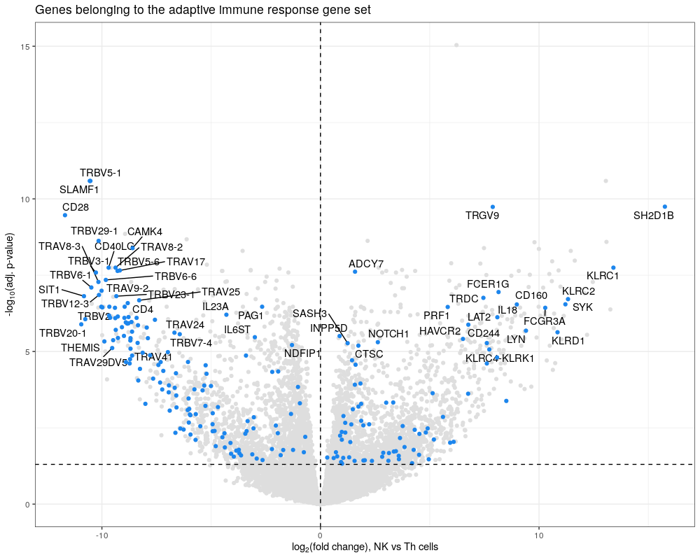
  </figure>


## Exercise 2 - Gene set enrichment analysis (GSEA)

Next, we will use functions of the clusterProfiler package to perform a gene set enrichment analysis (GSEA) of Gene Ontology terms. 
Look up the help of the `gseGO()` function. 

```r
?gseGO
```
We need a `geneList` argument. 
For this, we need to create a vector with the t-statistic of each gene, assign the gene symbol to each t-statistic in the vector (i.e. names), then sort the vector.

!!! warning
    A single gene can be labeled with different types of gene labels: Ensembl IDs, NCBI Entrez IDs, gene symbols, UniProt IDs, etc. 
		Therefore, first check whether the way the genes are labeled is supported by clusterProfiler using:
		```r
		  idType(OrgDb = "org.Hs.eg.db") # to determine allowed gene id type
		```

Create the named and sorted vector of t-statistics, then apply GSEA of the 
Gene Ontology Biological Process gene sets using the `gseGO()` function. 

```r
# We create a data frame of the DE results that contains 
# the unique gene symbols (caveat: genes with duplicated gene
# symbols may be lost)
# The data frame is ranked by descending t-statistic values:
ranked <- NK_vs_Th |>
  filter(!is.na(symbol), symbol != '') |>
  group_by(symbol) |>
  slice_max(abs(t), n = 1, with_ties = FALSE) |>
  ungroup() |>
  arrange(desc(t))

gl <- setNames(ranked$t, ranked$symbol)
head(gl)
tail(gl)
class(gl) # numeric

GO_NK_Th<-gseGO(gl, ont="BP",
                OrgDb = org.Hs.eg.db,
                keyType = "SYMBOL",
                minGSSize=30,
                maxGSSize = 800, # adaptive gene set is larger than 500
                eps=0,
                seed=T)
```
Explore the new object that was created. What is its structure? What does it contain? 
Is the adaptive immune response gene set significant? How many gene sets are down- or up-regulated?

??? done "Answer"
	```r
	  class(GO_NK_Th)
	  str(GO_NK_Th)
	  
	  View(GO_NK_Th@result)

	  # log2err is a column inherited from fgsea (which gseGO() calls).
	  # It reports the expected error (standard deviation) of the base-2 logarithm 
	  # of the estimated p-value from the multilevel Monte-Carlo permutation scheme.
	  # How to Interpret log2err:
	  # Precision of pvalue: Smaller values mean the estimated pvalue is more stable
	  # across permutations (for example, log2err around 0.5–1.5 is typical for 
	  # strong enrichments in fgsea).
	  # Large log2err: Indicates higher uncertainty in the pvalue 
	  # estimate for that GO term.
	  # NA or NaN: Often appears when pvalue calculation had issues—such as 
	  # unbalanced positive and negative gene-level statistics or 
	  # p-values likely overestimated.
    
	  res <- as.data.frame(GO_NK_Th)
	  res |> filter(Description == 'adaptive immune response')
	  table(ifelse(res$NES > 0, 'higher in NK', 'higher in Th'))

	```

Among the results, some gene sets seem to be a bit redundant based on the genes they contain (column "core_enrichment"). We can simplify the results by using the `simplify()` function of the clusterProfiler package:

```r
# Simplify:
?clusterProfiler::simplify

GO_NK_Th_simplify <- clusterProfiler::simplify(GO_NK_Th)
View(GO_NK_Th_simplify@result)

res <- as.data.frame(GO_NK_Th_simplify)
res |> filter(Description == 'adaptive immune response')
table(ifelse(res$NES > 0, 'higher in NK', 'higher in Th'))

```
Finally, you can export the results to a csv file, if you would want to summarize the results using [Revigo](http://revigo.irb.hr/) for example (see later in course).
To obtain the list of leading edge genes, split the corresponding column in the `@result` by using the slash. And if you want to obtain a full list
of genes belonging to a particular GO term, this information is also stored in the `@geneSets` slot.

```r
# you can export the results to a csv file (to summarize results using Revigo, see presentation)
write.csv(GO_NK_Th@result, "GO_GSEA_NK_vs_Th.csv",
          row.names = F, quote = F)

# How to obtain the list of leading edge genes for a gene set:
leading_edge <- res |>
  filter(Description == 'adaptive immune response') |>
  pull(core_enrichment) |> strsplit('/') |> unlist()
leading_edge

# How to obtain the list of all genes included in a GO term:
GO_NK_Th@geneSets$`GO:0002250`
```

As you will see later in the course, objects of type `enrichResult` or `gseaResult` generated by `clusterProfiler` functions can be used directly in some visualization functions. Therefore, you could save your full output object also to allow for easy visualization later.

```r

# You can also save the gseaResult object, which is useful to later 
# apply default plotting methods (see Exercise 3)
saveRDS(GO_NK_Th, "GO_NK_Th.rds")

# import a saved object:
GO_NK_Th<-readRDS("GO_NK_Th.rds")

```

**Bonus** In the context of single-cell RNA sequencing data for example, single-cells are clustered, and marker genes per cluster are obtained. In this case, we
don't always obtain a t-statistic or fold change value for every gene in the dataset, but rather a simple list of significant genes. With this list,
you can perform an over-representation analysis of the GO terms using ```enrichGO()```. The output will not contain enrichment scores, but rather p-values for
every gene set.

```r
nk_up_genes<-subset(NK_vs_Th, NK_vs_Th$logFC>0&NK_vs_Th$p.adj<=0.05)$symbol

# Provide list of significant genes for over-representation analysis of GO gene sets 
# using enrichGO():
GO_enrich<-enrichGO(gene=nk_up_genes,
                    OrgDb = org.Hs.eg.db,
                    keyType = "SYMBOL",
                    # ont="BP",
                    ont="MF", # ont="MF" is the default
                    minGSSize = 30,
 universe=NK_vs_Th$symbol) # may bug with barplot below if added, depending on version
View(GO_enrich@result)

# Check the class of the objects created:
class(GO_enrich)
# [1] "enrichResult"
# attr(,"package")
# [1] "DOSE"
class(GO_NK_Th)
# [1] "gseaResult"
# attr(,"package")
# [1] "DOSE"

```

This method can also be used if you have a list of genes involved in a disease, such as genes that are mutated in cancer, or lists of genes obtained by other omics methods, such as genes that have a transcription factor binding site in their promoter (ChIP-seq), etc.

## Exercise 3 - Visualization of enrichment results

Once we have performed a GSEA or over-representation analysis, we need of course to show the results and prepare figures for a publication. Several visualizations are possible,
depending on whether we want to show results for several gene sets at once, or a single gene set.
Along with the clusterProfiler package, the enrichplot package is installed, and 
its functions can be used directly on enrichResult or gseaResult objects. 

A dot plot allows to show results for several gene sets at once.

```r
# Dotplot on enrichResult and gseaResult objects:
enrichplot::dotplot(ora3) # genes up-reg in NK, 3 gene sets of interest, ordered by GeneRatio
enrichplot::dotplot(ora3, orderBy="p.adjust") # ordered by reverted p.adjust
enrichplot::dotplot(GO_NK_Th, x="NES") # top 10 shown
enrichplot::dotplot(GO_NK_Th_simplify, x="NES", showCategory = 15)

# Split per NES direction
enrichplot::dotplot(GO_NK_Th_simplify, showCategory = 10,
                    size="p.adjust", color="NES",
                    split = '.sign') + facet_grid(. ~ .sign)
  
# Select only 2 out of the significant gene sets:
ego_selection = GO_NK_Th[GO_NK_Th@result$ID == "GO:0002181" | GO_NK_Th@result$ID == "GO:0002228", asis=T]
dotplot(ego_selection, x="NES")
dotplot(ego_selection, x="p.adjust", size="NES")                  
                    
```

  <figure>
  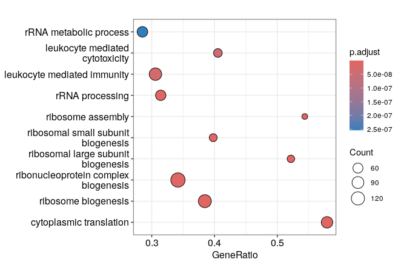
  </figure>


A common way to represent the enrichment score of a single gene set after GSEA is the barcode plot (i.e gsea plot), 
with the `gseaplot()` function that can be used directly on objects of class `gseaResult` (i.e. output by clusterProfiler functions). 

```r
# Barcode plot (i.e. gsea plot)
# You need the ID of the GO gene set to plot:
# GSEA plot for 1 gene set of interest, we need the info of the "ID" column
res |> filter(Description == "cytoplasmic translation") |> 
  dplyr::select(columns = c("ID", "Description", "NES"))

# For a gene set that is down-regulated in NK cells:
gseaplot(GO_NK_Th, geneSetID = "GO:0002181",
         title="GO:0002181 - cytoplasmic translation")
# And one that is up-regulated in NK cells
gseaplot(GO_NK_Th, geneSetID = "GO:0002443",
         title="GO:0002443 - leukocyte mediated immunity")

# customize second plot:
p <- gseaplot(GO_NK_Th, geneSetID = "GO:0002443",
              title="GO:0002443 - leukocyte mediated immunity") 
p[[2]] # default bottom plot 
p[[2]] + theme_minimal() + ggtitle("My pathway") # customized bottom plot 

# replace the bottom plot by my custom plot: 
p[[2]] <- p[[2]] + theme_minimal() + ggtitle("My pathway") + 
  xlab("Ranked list")
p 

# One that has a less strong NES (1.3)
gseaplot(GO_NK_Th, geneSetID = "GO:0032870",
         title="GO:0032870 - cellular response to hormone stimulus")
```

  <figure>
  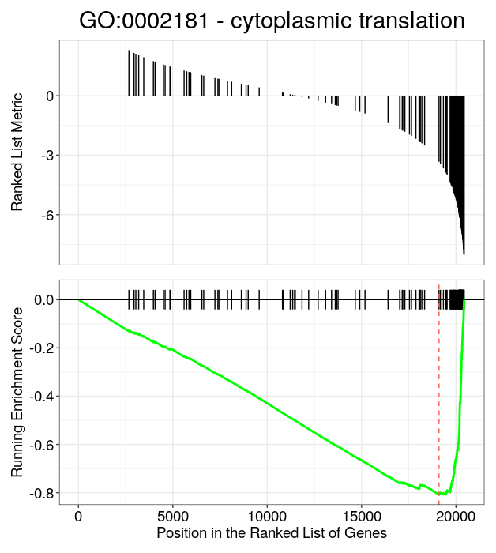
  </figure>

  <figure>
  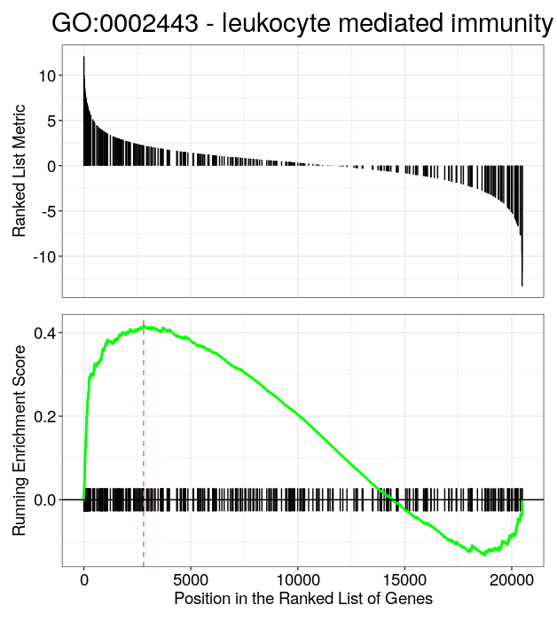
  </figure>

Because the `@result` slot is a data.frame, we can use base R graphics functions to create a barplot of p-values of top enriched GO terms. 
P-values are usually -log<sub>10</sub>-transformed, so that the very small p-values are emphasized compared to p-values that are closer to 0.05. The barplot() function comes from the graphics package. 

```r
# Using base R to create a barplot of the values in @result
# Barplot of -log10 p-values of top 10 GO gene sets:
par(mar=c(5,15,3,3))
graphics::barplot(rev(-log10(GO_NK_Th@result$p.adjust[1:10])),
                  horiz = T, 
                  names=rev(GO_NK_Th@result$Description[1:10]),
                  las=2, xlab="-log10(adj.p-value)",
                  cex.names = 0.7,
                  col="lightgreen") 
abline(v=-log10(0.05))
```

  <figure>
  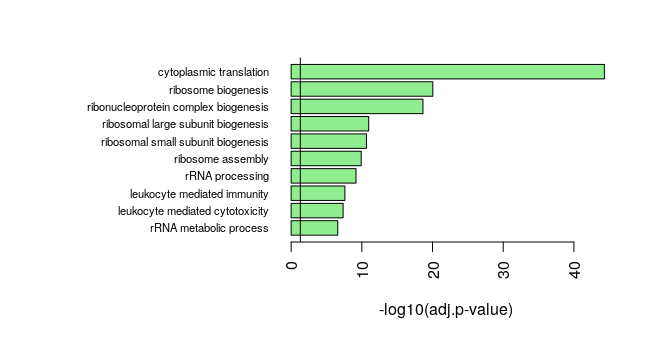
  </figure>
  
With results of an over-representation analysis, 
where the output is of class ```enrichResult```, 
the ```graphics::barplot()``` function can be used directly. You can either show the significant gene sets, or a custom selection of them.

```r
# barplot() can be directly used on enrichResult objects: but not on gseaResult objects
graphics::barplot(ora3)
graphics::barplot(ora3, color = "qvalue", x = "GeneRatio")

graphics::barplot(GO_NK_Th) # this is a gseaResult object
# Error in barplot.default(GO_NK_Th) : 
# 'height' must be a vector or a matrix
```

In publications, we often see barplots of normalized enrichment scores (NES), showing which gene sets are up-regulated and which are down-regulated.

Now that you know how to use the ```graphics::barplot()``` function, how would you create a barplot of NES of the top 10 up-regulated and the top 10 down-regulated genes sets,
 with red bars for the down-regulated gene sets and blue bars for the up-regulated gene sets?

??? done "Answer"
	```r
  		# Barplot of NES of the top GO gene sets, with different color for up- or down-reg gene sets:
  		# Create a df with the top 10 up- and down-reg pathways, and set color code:
  		sorted_GO_NK_Th <- GO_NK_Th@result %>%
    		arrange(NES) %>%
    		mutate(color = if_else(NES < 0, "red", "darkblue")) %>%
    		slice(c(1:10, (n() - 9):n()))

  		par(mar = c(5, 20, 3, 3))
  		barplot(sorted_GO_NK_Th$NES,
          		horiz = T, 
          		names = sorted_GO_NK_Th$Description,
          		las = 2, xlab = "NES",
          		cex.names = 0.7,
          		col = sorted_GO_NK_Th$color)
  		abline(v = 0)
      	
	```
	  <figure>
    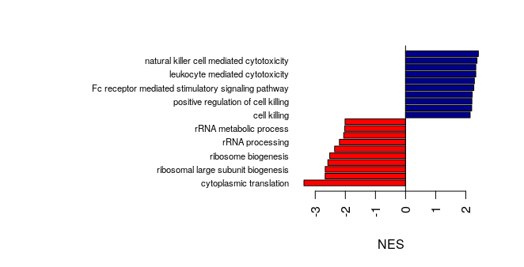
    </figure>

Here, we used the barplot function of the graphics package, but you can of course use ggplot2 functions. Please see the [Bonus code](https://sib-swiss.github.io/enrichment-analysis-training/bonus_code/#code-for-barplots-with-ggplot2) page for examples of barplots with ggplot2 (and tidyverse) functions. 

As we have seen, clusterProfiler provides several visualization methods that can be used directly on objects of class "gseaResult" or "enrichResult. These functions are implemented in the enrichplot package that was developped to go with clusterProfiler. Examples we have seen are
the dotplot and the gseaplot, but there is also the gene-concept network (cnetplot), the enrichment map (emapplot) and the ridge plots.
Feel free to consult the [chapter on visualization of the nice clusterProfiler book](http://yulab-smu.top/biomedical-knowledge-mining-book/enrichplot.html) to see all the possible options and test others than the ones listed here!

```r
# Gene concept network:
cnetplot(ora3, categorySize="pvalue")
cnetplot(GO_NK_Th, showCategory = 3)
# For a gseaResult object, we can overlay fold change for each gene:
cnetplot(GO_NK_Th, showCategory = 3, foldChange = gl)

```

  <figure>
  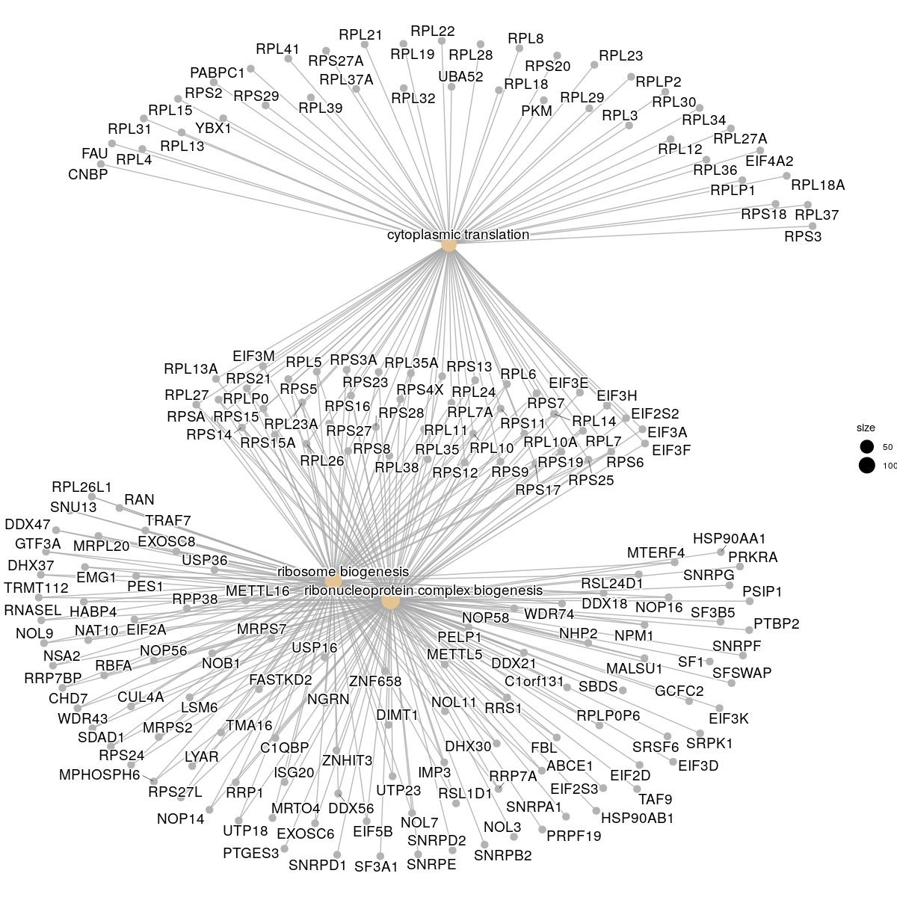
  </figure>


```r
# The enrichment map:
ego2 <- pairwise_termsim(GO_NK_Th)
emapplot(ego2, color="p.adjust")

# The ridge plots:
# Distribution of t-statistic for genes included in significant gene sets or in selected gene sets:
ridgeplot(GO_NK_Th)

# Select which GO terms to show in the ridge plot:
GO_NK_Th_selection <- GO_NK_Th[GO_NK_Th$ID == "GO:0002181", asis=T]
ridgeplot(GO_NK_Th_selection)
GO_NK_Th_selection <- GO_NK_Th[GO_NK_Th$ID %in% c("GO:0002181","GO:0022613",
                                                  "GO:0042254"), 
                                                  asis=T]
ridgeplot(GO_NK_Th_selection)
# Terms that contain the keyword "leukocyte"
GO_NK_Th_selection <- GO_NK_Th[grep("leukocyte",GO_NK_Th@result$Description), asis=T]
ridgeplot(GO_NK_Th_selection)

# What if you want to show all of the selected leukocyte terms with a dotplot?
dotplot(GO_NK_Th_selection, showCategory=Inf) # default is to plot 10

```

  <figure>
  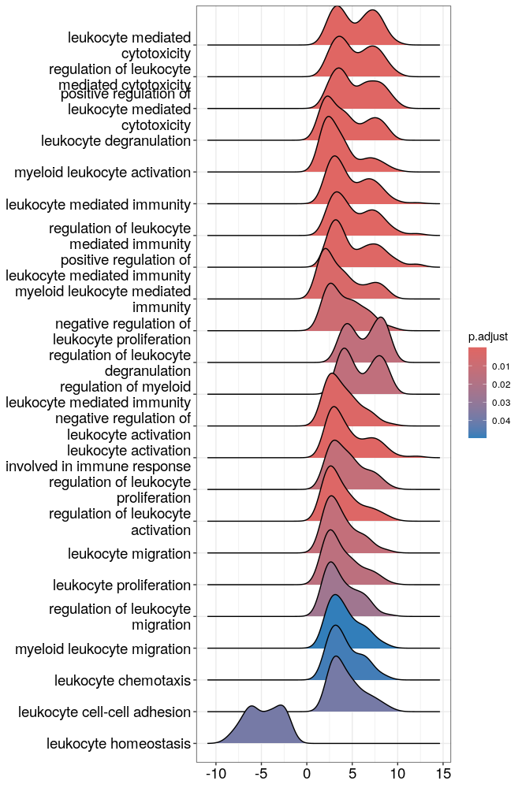
  </figure>

Please see the [Bonus code](https://sib-swiss.github.io/enrichment-analysis-training/bonus_code/#code-for-a-lollipop-plot-with-ggplot2) page for an example of a lollipop plot with ggplot2. 


## Exercise 4 (the last one!) - Enrichment of other collections of gene sets

We will now perform GSEA of other collections of gene sets, such as KEGG or Hallmark, or a custom list of gene sets.
Indeed, very often, researchers have their own gene sets in mind, either that they compiled from the literature, or that they defined from previous experiments. If this is the case for your experiment, you can generate an Excel file that contains one gene set per row, the 2 first columns contain the gene set ID and the gene set description, and the genes that belong to each gene set are listed in the next columns. To have an idea of
the structure of this file, open the .gmt file that we provided using Excel or a Text editor (NotePad, TextWrangler, BBEdit, etc).

In this exercise, we will first perform a GSEA of the 50 hallmark gene sets that can be downloaded from [MSigDB](http://www.gsea-msigdb.org/gsea/downloads.jsp), which we could import using `clusterProfiler::read.gmt()`. 
Alternatively, we can import the Hallmark gene sets using `msigdbr`. What is the format of the object that is created? Use the GSEA() function, by providing the named and sorted
vector of t-statistics we used above with gseGO().

```r
# Hallmark sets use gene symbols, so we can reuse `gl` without any 
# conversion. Check the arguments against your installed msigdbr version 
# (`?msigdbr`, `msigdbr_collections()`).

# What species and gene set collections are available via msigdbr?
msigdbr_species()  # Note that other species' symbols are orthology-mapped from human genes

msigdbr_collections()

# Import hallmark, convert to term2gene and run GSEA:
term2gene_h <- msigdbr(species = 'Homo sapiens', collection = 'H')
# Or alternatively:
# term2gene_h<-read.gmt("data/h.all.v2023.2.Hs.symbols.gmt")

head(term2gene_h)
length(unique(term2gene_h$gs_name)) # 50

# Run GSEA with the function that allows to use custom gene sets, 
# provide the named vector of t statistics
h_NK_vs_Th<-GSEA(gl, 
                 TERM2GENE = term2gene_h[,c("gs_name", "gene_symbol")],
                 eps=0,
                 seed=T)
View(h_NK_vs_Th@result) # 4
```

Finally, we can easily visualize the results:

```r
# A dotplot with GeneRatio or NES on the x-axis:
dotplot(h_NK_vs_Th)
dotplot(h_NK_vs_Th, x="NES", orderBy="p.adjust")

# A barcode plot:
gseaplot2(h_NK_vs_Th, geneSetID = "HALLMARK_MTORC1_SIGNALING",
           title="HALLMARK_MTORC1_SIGNALING")
```

  <figure>
  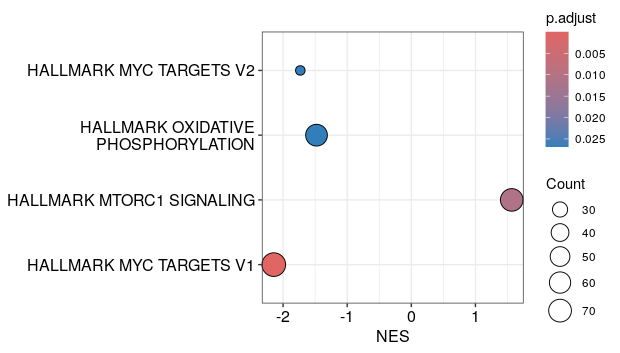
  </figure>

  <figure>
  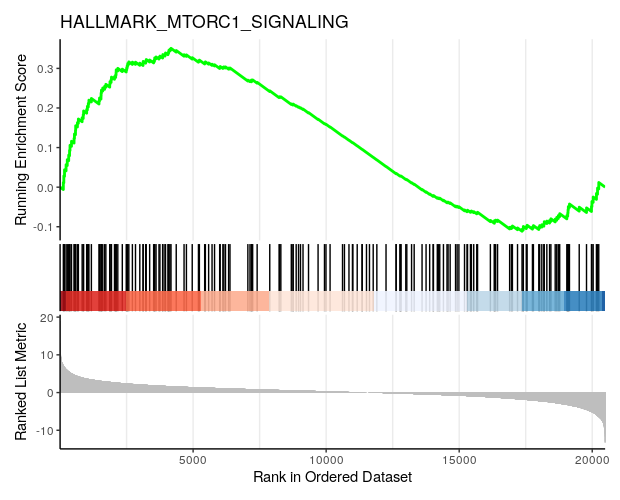
  </figure>


For GSEA of the KEGG gene sets, the gene IDs have to be NCBI Entrez gene IDs. ClusterProfiler provides the bitr() function to convert gene label types.

```r
# Check allowed gene ID types:
?gseKEGG
keytypes(org.Hs.eg.db) # same as idType()

# convert from= "ENSEMBL" to "SYMBOL" and "ENTREZID"

gene_convert <- bitr(as.character(NK_vs_Th$ensembl_gene_id), 
                     fromType="ENSEMBL", 
                     toType=c("SYMBOL", "ENTREZID"), OrgDb="org.Hs.eg.db",
                     drop=TRUE)
# Warning message:
# In bitr(NK_vs_Th$ensembl_gene_id, fromType = "ENSEMBL", toType = "ENTREZID",  :
#           18.28% of input gene IDs are fail to map...

head(gene_convert)
dim(gene_convert)
```

Similarly to the gseGO() function, we need to provide a named and sorted vector of t-statistics, the difference is that the names will be Entrez gene IDs.

```r
# GSEA of KEGG: create a vector of genes that are coded with the EntrezID:
ranked_entrez <- NK_vs_Th |>
  inner_join(gene_convert, by = c('ensembl_gene_id' = 'ENSEMBL')) |>
  group_by(ENTREZID) |>
  slice_max(abs(t), n = 1, with_ties = FALSE) |>
  ungroup() |>
  arrange(desc(t))
gl_kegg_list <- setNames(ranked_entrez$t, ranked_entrez$ENTREZID)


# run GSEA of KEGG (please note that it requires internet connection to download the KEGG annotations from http)
KEGG_NK_Th<-gseKEGG(gl_kegg_list, organism = "hsa", "ncbi-geneid",
                    minGSSize = 30,
                    eps=0,
                    seed=T)
# Reading KEGG annotation online: "https://rest.kegg.jp/link/hsa/pathway"...
# Reading KEGG annotation online: "https://rest.kegg.jp/list/pathway/hsa"...
# Reading KEGG annotation online: "https://rest.kegg.jp/conv/ncbi-geneid/hsa"...

```
!!! warning
    If you have issues with the ```gseKEGG()``` function and download of the KEGG collection via internet is blocked, an alternative is to use the msigdbr package, as shown in the [Bonus code](https://sib-swiss.github.io/enrichment-analysis-training/bonus_code/#msigdbr-package) page.


Explore the new object that was created. What is its structure? What does it contain? How many gene sets are up-regulated? Is their an immune-related gene set significant?
Because we had NK cells in our dataset, is the [NK cell-mediated cytotoxicity](https://www.genome.jp/pathway/hsa04650) KEGG gene set significant? What is the total number of built-in
KEGG gene sets and how can you view the genes included in a particular gene set?

??? done "Answer"
	```r
		# Explore the object:
		class(KEGG_NK_Th)
		str(KEGG_NK_Th)
		View(KEGG_NK_Th@result)

		# Up-regulated gene sets:
		summary(KEGG_NK_Th@result$NES>0)
		#    Mode   FALSE    TRUE 
		# logical      7      21

		KEGG_NK_Th@result |> filter(grepl("immune", Description))

		KEGG_NK_Th@result |> filter(grepl("Natural killer", Description))

		# How many built-in KEGG pathways are there?
		length(KEGG_NK_Th@geneSets)
		# Genes involved in Natural killer cell mediated cytotoxicity (hsa04650)
		KEGG_NK_Th@geneSets$hsa04650 # coded as Entrez Gene ID...
	```

Once you have performed a GSEA of the KEGG pathways, it is possible to overlay the fold change values of your genes on top of the
KEGG pathway maps available online. For this, create a named vector of fold change values, where the non-significant genes will be grey, while the up- and down-
regulated genes will be colored in the KEGG pathway map. The pathview() function comes from the pathview package (surprisingly...)

```r

# Overlay of fold change value on KEGG pathway figure:
library(pathview)

# pathview map with non-significant genes in grey:
# set log fold change of non-significant genes to 0:
NK_vs_Th$logFC_0<-ifelse(NK_vs_Th$p.adj>0.05, 0, NK_vs_Th$logFC)

# create named vector of fold change values:
genePW<-NK_vs_Th$logFC_0
names(genePW)<-NK_vs_Th$symbol

# Create pathview map for Ribosome = hsa03010
?pathview
pathview(gene.data  = genePW,
         pathway.id = "hsa03010",
         species    = "hsa",
         gene.idtype = "SYMBOL")

# Create pathview map of Natural killer cell mediated cytotoxicity = hsa04650
pathview(gene.data  = genePW,
         pathway.id = "hsa04650",
         species    = "hsa",
         gene.idtype = "SYMBOL",
         low = list(gene = "lightblue", cpd = "magenta"), 
         mid = list(gene = "gray", cpd = "gray"), 
         high = list(gene = "red", cpd = "yellow"))


```

  <figure>
  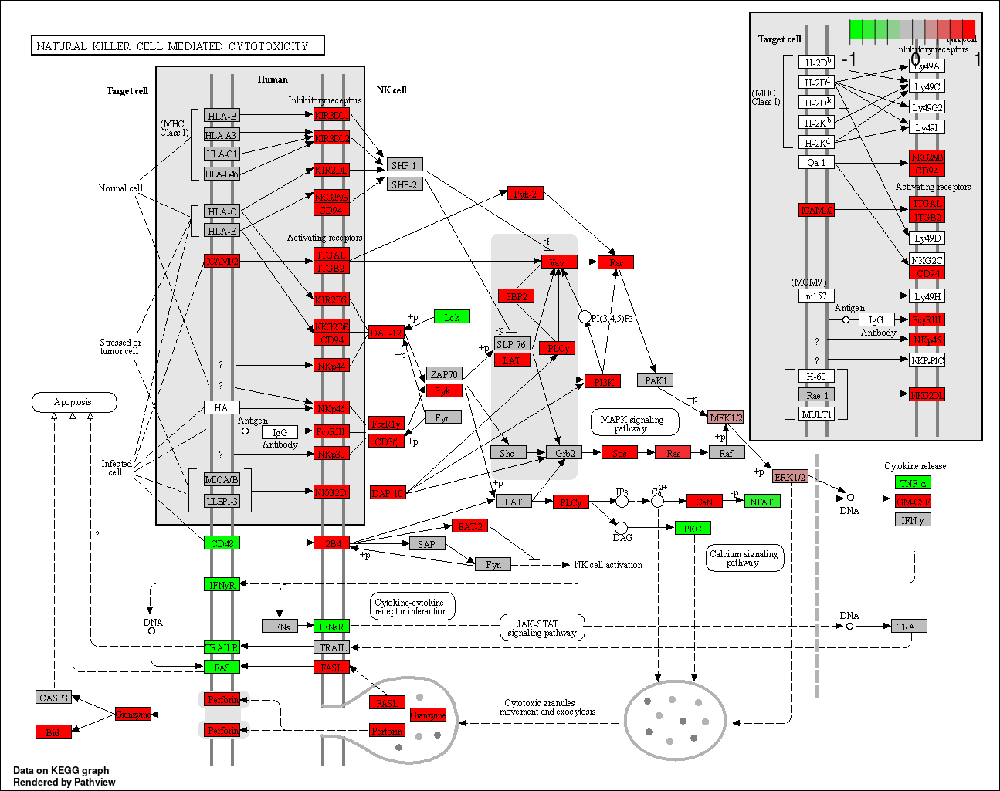
  </figure>


**The End**

## Feedback
Thanks for attending this course! Don't forget to give honest feedback via the link sent by the course organizer.


## Extra exercise for ECTS credits
- Perform GSEA of the NK vs Th data using the Reactome gene sets either downloaded using the `msigdbr`  packege or downloaded from the 
MSigDB website [here](http://www.gsea-msigdb.org/gsea/msigdb/download_file.jsp?filePath=/msigdb/release/2023.1.Hs/c2.cp.reactome.v2023.1.Hs.symbols.gmt).
* How many gene sets are significantly enriched?  
* Generate a barplot of the NES of all significant gene sets, with the bars ordered according to NES value.  
* Generate a barcode plot (i.e. gsea plot) for the gene set with the lowest NES.  

**Steps**

* Import the reactome gene sets using `msigdbr()` with arguments `collection="C2"` and `subcollection="CP:REACTOME"`, or import from the provided file `c2.cp.reactome.v2023.1.Hs.symbols.gmt` using `read.gmt()`.  
* Use the `GSEA()` function providing a sorted named vector of t-statistics and the reactome gene sets, and use argument `minGSSize=30`.  
* Count the number of significant adjusted p-values.  
* Use `barplot()` and `gseaplot()` for the visualization of the results.  


